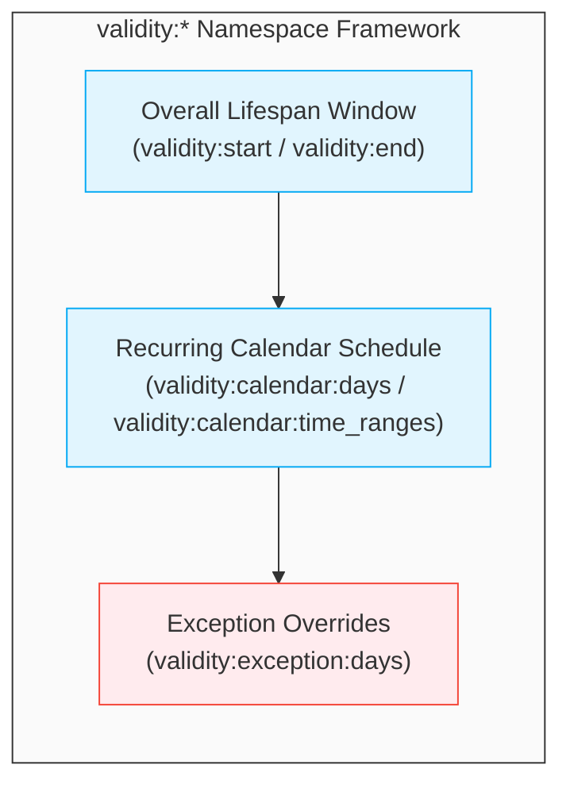

# GeoChangeset Addendum B - Temporal Validity Standard Profile (v0.1-Draft)

## Preface

This addendum details the standard syntax for expressing complex temporal constraints within the flat key-value `<tag>` model of GeoChangeset. It provides clear, programmatically parseable structures to handle dynamic scheduling—such as overnight restrictions, weekly recurring calendar profiles, and public holiday exceptions—mapping directly to the structural intent of the **DATEX II `Validity**` and **`Period`\*\* classes.

---

## 1. Architectural Overview

To avoid forcing parsers to instantiate heavy, brittle full-scale calendar processors for every geometry entry, GeoChangeset separates overall lifecycle boundaries from internal recurring schedules using the `validity:*` namespace.



---

## 2. Core Validity Tag Reference Matrix

| Key                             | Value Type | Example                   | Description                                                                                        |
| ------------------------------- | ---------- | ------------------------- | -------------------------------------------------------------------------------------------------- |
| `validity:timezone`             | String     | `Europe/Berlin`           | The IANA Time Zone database identifier used to evaluate local time expressions. Defaults to `UTC`. |
| `validity:start`                | ISO 8601   | `2026-07-20T00:00:00Z`    | Absolute commencement timestamp of the overall operational macro-window.                           |
| `validity:end`                  | ISO 8601   | `2026-10-31T23:59:59Z`    | Absolute expiration timestamp of the overall operational macro-window.                             |
| `validity:calendar:days`        | Comma List | `MO,TU,WE,TH,FR`          | Target active days using standardized ISO 8601 two-letter weekday codes or functional tokens.      |
| `validity:calendar:time_ranges` | Comma List | `06:00-09:00,16:00-19:00` | Local time brackets when the condition applies. Supports overnight spanning.                       |
| `validity:exception:days`       | Comma List | `PH`                      | Days explicitly excluded from the active schedule (e.g., ignoring public holidays).                |

---

## 3. Micro-Syntax Token Definitions

### A. Weekday Codes (`validity:calendar:days`)

Values must be expressed as a comma-separated array of the following upper-case tokens:

- **Standard Days**: `MO`, `TU`, `WE`, `TH`, `FR`, `SA`, `SU`
- **Macro Tokens**: `WEEKDAYS` (Equivalent to `MO,TU,WE,TH,FR`), `WEEKENDS` (Equivalent to `SA,SU`)

### B. Time Ranges (`validity:calendar:time_ranges`)

- Format must follow `HH:mm-HH:mm` using 24-hour local time notation.
- **Overnight Spanning**: If the first time element is greater than the second element (e.g., `22:00-06:00`), the window is parsed as beginning at 22:00 on the active day and expiring at 06:00 on the following morning.

### C. Exception Codes (`validity:exception:days`)

- `PH`: Public Holidays (evaluated against the local regional calendar dictated by the spatial bounds or jurisdiction of the geometry data creator).
- `FD`: Days of exceptional weather or environmental alarms (triggered by dynamic secondary feeds).

---

## 4. Reference XML Implementations

### Example 1: Nighttime-Only Speed Restriction (Overnight Spanning)

A noise-protection speed limit reduction active strictly between 22:00 (10 PM) and 06:00 (6 AM) local time every night.

```xml
<geometry id="noise_zone_a1" version="1" changeset="1150" type="openlr-binary">
  <![CDATA[CwkBcns4OCQZBwD9/1YAFgEFAw==]]>
  <!-- Operational Layer Content -->
  <tag k="traffic:restriction" v="environmental_emergency"/>
  <tag k="traffic:flow:speed_max" v="80"/>

  <!-- Temporal Validity Schedule -->
  <tag k="validity:timezone" v="Europe/Berlin"/>
  <tag k="validity:start" v="2026-07-19T00:00:00Z"/> <!-- Enforced indefinitely -->
  <tag k="validity:calendar:days" v="MO,TU,WE,TH,FR,SA,SU"/>
  <tag k="validity:calendar:time_ranges" v="22:00-06:00"/>
</geometry>

```

### Example 2: Recurring Peak-Hour HOV Lane Activation (Split Windows)

A high-occupancy vehicle (HOV) lane restriction active exclusively on weekdays during morning and evening rush hours, skipping public holidays.

```xml
<geometry id="hov_lane_09" version="4" changeset="1151" type="geojson">
  <![CDATA[
  {
    "type": "LineString",
    "coordinates": [[6.77, 51.22], [6.78, 51.23]]
  }
  ]]>
  <!-- Operational Layer Content -->
  <tag k="traffic:restriction" v="regulation_override"/>
  <tag k="traffic:lanes:vector" v="hov,open,open"/>

  <!-- Temporal Validity Schedule -->
  <tag k="validity:timezone" v="Europe/London"/>
  <tag k="validity:start" v="2026-09-01T00:00:00Z"/>
  <tag k="validity:end" v="2026-12-31T23:59:59Z"/>
  <tag k="validity:calendar:days" v="WEEKDAYS"/>
  <tag k="validity:calendar:time_ranges" v="07:00-09:30,16:30-19:00"/>
  <tag k="validity:exception:days" v="PH"/>
</geometry>

```

### Example 3: Weekend Seasonal Market Closure

A recurring weekend closure of a downtown geometry corridor spanning the summer tourism season.

```xml
<geometry id="market_street_12" version="1" changeset="1152" type="gml">
  <![CDATA[
  <gml:LineString xmlns:gml="http://www.opengis.net/gml/3.2" gml:id="ls_m12">
    <gml:posList srsDimension="2">51.22 6.77 51.23 6.78</gml:posList>
  </gml:LineString>
  ]]>
  <!-- Operational Layer Content -->
  <tag k="traffic:restriction" v="special_event"/>
  <tag k="traffic:impact" v="full_closure"/>

  <!-- Temporal Validity Schedule -->
  <tag k="validity:timezone" v="Europe/Paris"/>
  <tag k="validity:start" v="2026-06-01T00:00:00Z"/>
  <tag k="validity:end" v="2026-08-31T23:59:59Z"/>
  <tag k="validity:calendar:days" v="WEEKENDS"/>
  <tag k="validity:calendar:time_ranges" v="06:00-20:00"/>
</geometry>

```
