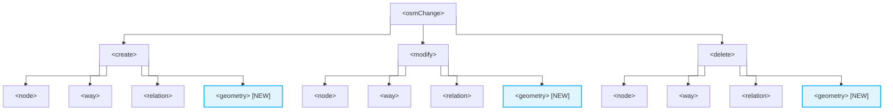

# GeoChangeset File Format Specification (v0.1-Draft)

## Preface

The key words "MUST", "MUST NOT", "REQUIRED", "SHALL", "SHALL NOT", "SHOULD", "SHOULD NOT", "RECOMMENDED", "MAY", and "OPTIONAL" in this document are to be interpreted as described in RFC 2119.

## 1. Introduction & Abstract

Modern mobility platforms frequently exchange high-frequency spatial updates—such as current floating car speed, temporary work zones, dynamic detours, and lane-level traffic constraints—without mutating the underlying base map topology. Traditional mapping deltas, like the OpenStreetMap `OsmChange` (`.osc`) format, are optimized exclusively for topological primitives: nodes, ways, and relations.

**GeoChangeset** bridges this gap by extending the transactional architecture of `OsmChange` to support independent, highly expressive spatial payloads. It introduces a first-class `<geometry>` element alongside classic primitives inside `<create>`, `<modify>`, and `<delete>` blocks. By natively encapsulating GeoJSON, GML, and OpenLR location references, GeoChangeset eliminates the need to decompose complex geometries into synthetic nodes and ways, facilitating easier translation from data in DATEX-II and ISO/TC 204 formats.

---

## 2. Core Architecture & Structural Lifecycle

A GeoChangeset document uses the `<osmChange>` root element. Inside the root, operations are batched into explicit transactional blocks representing the structural lifecycle of map elements.



### Supported Operations

- **`<create>`**: Instantiates a new map primitive or independent geometry layer.
- **`<modify>`**: Mutates an existing primitive or modifies a geometry payload, coordinates, or associated tags.
- **`<delete>`**: Removes an element or geometry layer from the operational canvas.

---

## 3. The `<geometry>` Element Specification

The `<geometry>` element encapsulates non-topological spatial representations. It isolates coordinate streams and linear referencing strings from the strict node-way-relation dependency model.

### 3.1 Attributes

| Attribute   | Type    | Multiplicity | Description                                                                                                                                                                   |
| :---------- | :------ | :----------- | ----------------------------------------------------------------------------------------------------------------------------------------------------------------------------- |
| `id`        | String  | 1..1         | A unique tracking identifier for the geometry instance. Systems SHOULD use UUIDs or namespaced strings to prevent ID space collisions with native base map elements.          |
| `version`   | Integer | 1..1         | The incremental version of the entity for validation and cache-invalidation. Starts at `1` upon creation.                                                                     |
| `changeset` | Integer | 0..1         | The numeric identifier of the parent synchronization transaction grouping.                                                                                                    |
| `type`      | String  | 1..1         | The structural identifier dictating which explicit parsing protocol to execute. Must match one of the four allowed types: `geojson`, `gml`, `openlr-binary`, or `openlr-xml`. |
| `srsName`   | String  | 0..1         | The Spatial Reference System URI. Defaults to `urn:ogc:def:crs:EPSG::4326` (WGS 84). Mandatory when using GML payloads that rely on alternative projecting planes.            |

### 3.2 Child Elements

1.  **Data Payload**: Text, markup, or encapsulated string blocks containing the spatial object. To protect structural markup parsing, text payloads containing reserved XML entities (such as `<` or `&`) MUST be wrapped in a `<![CDATA[ ... ]]>` section.
2.  **`<tag>` elements**: Zero or more explicit `<tag k="KEY" v="VALUE" />` elements to decorate the geometry with semantic metadata, mirroring standard OpenStreetMap tagging patterns.

---

## 4. Geometry Type Schema Formats

### 4.1 GeoJSON (`type="geojson"`)

- **Structural Constraint**: The payload MUST evaluate strictly to a valid RFC 7946 GeoJSON Geometry object (e.g., `Point`, `LineString`, `Polygon`, `MultiLineString`, `MultiPolygon`).
- **Metadata Separation**: The payload MUST NOT contain full GeoJSON `Feature` or `FeatureCollection` wrappers. Semantic keys and attributes must live exclusively within the external `<tag>` elements to preserve format consistency.

### 4.2 GML (`type="gml"`)

- **Structural Constraint**: Payloads must evaluate to schema-compliant GML (Geography Markup Language) strings.
- **DATEX II Profiling**: When used for European or inter-urban transport profiles, the elements inside the payload block should map to the ISO 19136 profiles designated by the DATEX II spatial data rules (e.g., `gml:LineString`, `gml:Point`).

### 4.3 OpenLR Binary (`type="openlr-binary"`)

- **Structural Constraint**: The payload MUST be a plain text, Base64-encoded string representing the serialized binary payload of an OpenLR dynamic location reference.
- **Parsing Target**: Intended for low-bandwidth environments where parsers pass the extracted string directly to raw byte-stream decoders.

### 4.4 OpenLR XML (`type="openlr-xml"`)

- **Structural Constraint**: The payload MUST be a structured, valid OpenLR XML fragment matching the openlr.org XML schema specification.
- **DATEX II Profiling**: Maps directly to the `linearLocationReference` and `pointLocationReference` payload segments embedded within DATEX II location sub-models.

---

## 5. Comprehensive Document Example

The following production-representative `.geosc` payload illustrates the implementation of all four geometry paradigms across different transactional actions.

```xml
<?xml version="1.0" encoding="UTF-8"?>
<osmChange version="0.6" generator="GeoChangeset Spec Engine v1.0">

  <!-- 1. CREATE ACTION BLOCK -->
  <create>
    <!-- Case A: GeoJSON LineString representing a dynamic lane closure -->
    <geometry id="geo_lane_44102" version="1" changeset="9821" type="geojson">
      <![CDATA[
      {
        "type": "LineString",
        "coordinates": [
          [6.773450, 51.227740],
          [6.774910, 51.228120],
          [6.776100, 51.229450]
        ]
      }
      ]]>
      <tag k="mobility:restriction" v="left_lane_closed"/>
      <tag k="reason" v="emergency_roadwork"/>
      <tag k="start_time" v="2026-07-19T00:00:00Z"/>
    </geometry>

    <!-- Case B: OpenLR Binary Base64 String for dynamic traffic speed distribution -->
    <geometry id="lr_link_99812" version="1" changeset="9821" type="openlr-binary">
      <![CDATA[CwkBcns4OCQZBwD9/1YAFgEFAw==]]>
      <tag k="mobility:feed" v="vti_flow_data"/>
      <tag k="maxspeed:conditional" v="60"/>
    </geometry>
  </create>

  <!-- 2. MODIFY ACTION BLOCK -->
  <modify>
    <!-- Case C: Updating a DATEX II compliant GML definition for an expanding hazard zone -->
    <geometry id="gml_zone_1102" version="3" changeset="9822" type="gml" srsName="urn:ogc:def:crs:EPSG::4326">
      <" gml:id="ls_1102">
        <gml:posList srsDimension="2">51.227740 6.773450 51.228120 6.774910 51.230110 6.778010</gml:posList>
      </gml:LineString>
      ]]>
      <tag k="hazard:type" v="oil_spill"/>
      <tag k="severity" v="critical"/>
    </geometry>

    <!-- Case D: Modifying tags on a structured OpenLR XML dynamic point location -->
    <geometry id="lr_xml_0094" version="2" changeset="9822" type="openlr-xml">
      <">
        <poiLocation>
          <geoCoordinates>
            <longitude>6.77345</longitude>
            <latitude>51.22774</latitude>
          </geoCoordinates>
        </poiLocation>
      </openlrPointLocationReference>
      ]]>
      <tag k="status" v="resolved"/>
      <tag k="clearance_time" v="2026-07-19T02:30:00Z"/>
    </geometry>
  </modify>

  <!-- 3. DELETE ACTION BLOCK -->
  <delete>
    <!-- Case E: Tearing down an expired geometry instance -->
    <geometry id="geo_lane_44102" version="2" changeset="9823" type="geojson" />
  </delete>

</osmChange>
```

## 6. Formal W3C XML Schema Definition (XSD) Extension

To incorporate the GeoChangeset specification into validation workflows, your main osmChange.xsd file must adopt the following schema structure. This snippet replaces the legacy actionBlock configuration to cleanly accommodate the <geometry> complex type definition.

```xml
<?xml version="1.0" encoding="UTF-8"?>
<xs:schema xmlns:xs="[http://www.w3.org/2001/XMLSchema](http://www.w3.org/2001/XMLSchema)" elementFormDefault="qualified">

  <!-- Reusable OSM Tag Component Definition -->
  <xs:complexType name="tagType">
    <xs:attribute name="k" type="xs:string" use="required" />
    <xs:attribute name="v" type="xs:string" use="required" />
  </xs:complexType>

  <!-- Modified OsmChange Action Block Choice Selection -->
  <xs:complexType name="actionBlock">
    <xs:choice minOccurs="0" maxOccurs="unbounded">
      <xs:element name="node" type="xs:anyType"/>
      <xs:element name="way" type="xs:anyType"/>
      <xs:element name="relation" type="xs:anyType"/>
      <!-- Core Specification Injection Point -->
      <xs:element name="geometry" type="geometryType"/>
    </xs:choice>
  </xs:complexType>

  <!-- Precise Geometry ComplexType Schema Definition -->
  <xs:complexType name="geometryType">
    <xs:sequence>
      <!-- Accommodates clean strings (Base64), raw XML blocks (GML/OpenLR XML), or GeoJSON data strings -->
      <xs:any processContents="skip" minOccurs="0" maxOccurs="1"/>
      <xs:element name="tag" type="tagType" minOccurs="0" maxOccurs="unbounded"/>
    </xs:sequence>
    <xs:attribute name="id" type="xs:string" use="required"/>
    <xs:attribute name="version" type="xs:integer" use="required"/>
    <xs:attribute name="changeset" type="xs:integer" use="optional"/>
    <xs:attribute name="type" use="required">
      <xs:simpleType>
        <xs:restriction base="xs:string">
          <xs:enumeration value="geojson"/>
          <xs:enumeration value="gml"/>
          <xs:enumeration value="openlr-binary"/>
          <xs:enumeration value="openlr-xml"/>
        </xs:restriction>
      </xs:simpleType>
    </xs:attribute>
    <xs:attribute name="srsName" type="xs:string" use="optional"/>
  </xs:complexType>

  <!-- Document Root Element Definition Framework -->
  <xs:element name="osmChange">
    <xs:complexType>
      <xs:choice minOccurs="0" maxOccurs="unbounded">
        <xs:element name="create" type="actionBlock"/>
        <xs:element name="modify" type="actionBlock"/>
        <xs:element name="delete" type="actionBlock"/>
      </xs:choice>
      <xs:attribute name="version" type="xs:string" use="required"/>
      <xs:attribute name="generator" type="xs:string" use="required"/>
    </xs:complexType>
  </xs:element>

</xs:schema>

```

## 7. Parser Implementer Guidelines & Concurrency Control

Namespacing and Elements: Parsers built strictly for legacy OSM architectures MUST use a selective schema parsing pass to safely skip or drop <geometry> sections without causing memory crashes, preserving backward validation pipelines.

String Sanitization: Consumers handling `type="geojson"` layers must feed the text within the parsed target node directly into a standard JSON parser engine. If the payload is wrapped inside a CDATA block, trailing or leading carriage returns (\r\n) must be trimmed out prior to serialization handoff.

Coordinate Order Safety: Following the default WGS 84 specification string (urn:ogc:def:crs:EPSG::4326), geojson coordinate values MUST use standard Longitude/Latitude sequencing. In contrast, gml payloads conform strictly to the parameter order enforced by the selected srsName attribute or explicit parent namespaces defined by the DATEX-II implementation guide.
